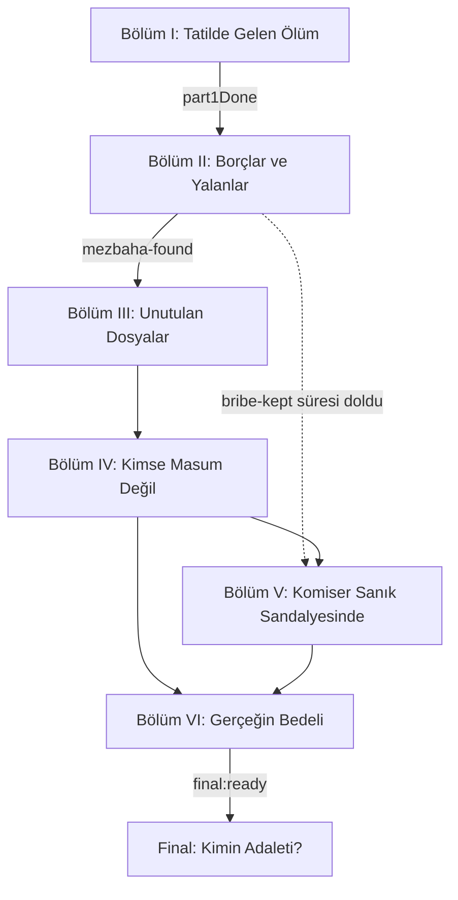

# 4. Ana hikâyenin bölüm iskeleti

Bölümler zorunlu görevler değil, **anlatı evreleridir**. Oyuncu birçok olayı
farklı sırayla keşfedebilir. Bir bölüm, onu açan bayraklarla başlar ve onu
kapatan bayraklarla biter; aradaki her şey sandbox.

Yollar birleşebilir, ama önceki seçimlerin sonuçlarını taşımalıdır
(bayraklar ve sayılar kalıcıdır).

## Şablon

```markdown
## Bölüm N — Ad
**Durum:** [KANON] / [ÖNERİ]
**Açılış:** hangi bayrak(lar)
**Kapanış:** hangi bayrak(lar)

- **Oyuncunun amacı:** ...
- **Öğrenilebilecek gerçekler:** (01'den hangileri, hangi düzeyde)
- **Açılan karakterler:** ...
- **Deliller ve uygulamalar:** ...
- **Büyük kararlar:** (05'teki ikilemler)
- **Değişen sayılar:** (trust, pressure, integrity, witnessDanger...)
- **Yan hikâyeler:** (bu evrede açılabilenler)
- **Alternatif yollar:** bir yol kapanırsa bilgiye nereden ulaşılır
```

## Bölüm I — Tatilde Gelen Ölüm
**Durum:** [KANON]
**Açılış:** oyunun başı
**Kapanış:** `part1Done`

- **Oyuncunun amacı:** Ne olduğunu anlamak, ekibi organize etmek.
- **Öğrenilebilecekler:** Berat'ın ölümü, ilk ifadeler, otopsinin intihar
  süsünü çürütmesi.
- **Uygulamalar:** MatesApp (Özge), Poltel (ifadeler, otopsi), News (ilk haber).
- **Kararlar:** Özge'ye sert mi meraklı mı yaklaşılacağı (`trust:Özge`).

## Bölüm II — Borçlar ve Yalanlar
**Durum:** [KANON] (kısmen)
**Açılış:** `part1Done`
**Kapanış:** `mezbaha-found`

- **Oyuncunun amacı:** Furkan'ı ve Adil'i bulmak.
- **Öğrenilebilecekler:** Paket, borç, parmak izi, kafe, defter, makam aracı,
  yanık harita, mezbaha.
- **Uygulamalar:** Harita (görevler), Pano ve Laboratuvar, Sinstagram (Furkan,
  Yusuf, Deniz, gizli Adil hesabı), Kayıtlar (tehdit), ZaferBank (rüşvet).
- **Kararlar:** Furkan sorgusunun tonu (`trust:Doğa`), Behram'la ilişki,
  rüşvetin iadesi (İkilem 1'in ilk adımı, `bribe-kept` süreli olayı).
- **Yan hikâyeler:** ilk bağımsız dosyalar (05).

## Bölüm III — Unutulan Dosyalar
**Durum:** [KANON, taslak] (28.10.2026)
**Açılış:** `mezbaha-found` (ya da daha önce: `heard:dead-line`, `news:old-case-found`)
**Kapanış:** `kerem:contact` (Kerem ilk kez yazar)

- **Oyuncunun amacı:** Berat'ın peşinden çıkan deri ceketli adamı bulmak.
- **Öğrenilebilecekler:** Ece Aydın'ın adı ve ölümü; Kerem'in adı, vakıfta
  gönüllü olduğu ve kameradaki adam olduğu; Berat'ı son iki ayda en çok Ece'nin
  hattından arandığı; narkotiğin cuma gecelerine göz yumduğu; kaymakamın
  Yılmaz'ın rakibi olduğu.
- **Kerem'e giden yollar** (birbirinden bağımsız):
  1. Yırtık fotoğraf + kamera karesi → Atakan'a sor (aynı adam mı?) → 8 dk
     sonra kart netleşir: vakıf gönüllü kartı → vakıf haritada → "Gönüllü
     kartının fotoğrafını göster" → Kerem'in adı.
  2. Sesli mesaj → Özge hattı sorgular (üç yıl önce ölmüş bir kadın) → "Hattın
     sahibi kim?" → Ece Aydın.
  3. News arşivinde takipsizlik haberi → Özge'ye kızın adını sor → Ece Aydın.
  4. Ece'nin adıyla → Sinstagram'da `ece.aydin` (Berat'ın "Aramıza hoş geldin"
     yorumu) → yorumlardaki `k.aydin` (bio: "Kardeşi.") → Kerem'in adı.
  5. Ece'nin adıyla → haritada Aydın ailesinin evi → komşular: "sakallı, deri
     ceketli" → Kerem'in adı.
- **Kimlik:** Kerem'in adı + kamera karesi + (aynı adam ya da gönüllü olduğu)
  → Atakan ehliyet fotoğrafını karşılaştırır → `kerem:identified`.
- **Kerem yazar:** Ece'nin hattından: "Kızlardan biri hâlâ hayatta. Cumaya
  kadar." Buluşma (`kerem:meeting`) Bölüm IV'te.
- **Kararlar:** Kerem'i sessizce mi aramalı, herkese mi duyurmalı
  (`kerem:wanted`); Ece'nin odasına izinsiz girmek (`player:dirty-hands`).
- **Gizli son ipuçları (`doubt`):** annenin sesli mesajı, Özge'nin sızıntı
  cevabı, İnanç'ın telefon kaydı, Erdi'nin "nerede olduğunu bilmiyoruz"u,
  Selin'in "gece üçte arayan".

## Bölüm IV — Cuma Gecesi
**Durum:** [KANON, taslak] (28.10.2026)
**Açılış:** `kerem:contact`
**Kapanış:** `storage:entered` (Melis kurtarılır ya da ölü bulunur)

Eski taslaktaki "Kimse Masum Değil" konuları (Hakan, ekibin kişisel
hikâyeleri, İkilem 3, 4, 9) Bölüm V'e kaydı.

- **Buluşma:** Kerem yüz yüze, tek kişiyle görüşmek ister. Komiser "yurt
  dışında" olduğu için ya ekipten birini gönderir (güveni 40 ve üstü olanlar:
  Özge, Doğa, Atakan, İnanç; Behram yardım ettiyse o) ya da ekibi toplayıp
  buluşma yerini sardırır (pusu). "Yurt dışındayım" demek Kerem'in "Öyle
  mi?" cevabıyla `doubt` artırır. Buluşma 10 dk oyun süresi sonra olur.
- **Gidenin raporu:** Kerem itiraf eder, kızın adını (Melis) ve şartını
  söyler: cuma gecesi serbest kalıp Adil'i ve danışmanı bekleyecek. Berat'ın
  telefonunu verir; son kayıt Berat'ın sesi: "Kerem'e yarın her şeyi
  vereceğim." Oyuncu Berat'ın pişman olduğunu burada öğrenir.
- **İkilem 2 (gidenin sohbetinde):**

  | Seçim | Kızın yeri | Bedel |
  | --- | --- | --- |
  | Gözaltına al | Kerem söylemez. Orhun'un bulduğu "SH-4" anahtarı ya da Behram'ın listesi + Furkan'ın cuma geceleri | Süre kaçabilir |
  | Savcıyla anlaş | Hemen | pressure +10 |
  | Gitsin | Hemen | Kirli eller, integrity −20, gidenin güveni −10, Kerem Adil'in peşine düşer |
  | (Pusu) | Kerem kaçar, yeri söylemez; 15 dk sonra "kız için" yine söyler | integrity −5, witnessDanger +10 |

- **Cuma:** Kerem ilk yazdığında 60 dk oyun süresi başlar. Melis kurtarılmadan
  biterse `girl:lost`: depoda geç kalınır, Melis ölü bulunur.
- **Sonrası:** Doğa Melis'in ifadesini alır (takım elbiseli sorgucu: "Vakıf
  seni bu kadar okuttu"; Emre iki hafta önce götürülmüş) ve tanık koruma
  kararı. Erdi kurtarma başarısını sahiplenir; gözaltıda "dosyayı kapat"
  der; kaçışta öfkelenir. Baba katilin adını sorar. News üç ayrı haberle
  sonucu yazar.
- **Bölüm V'e bırakılanlar:** Emre nerede, danışman kim, Kerem Adil'in peşinde
  (`kerem:hunting`), Berat'ın telefonundaki kayıtlarla örtbasın ifşası,
  Hakan.

## Bölüm V — Komiser Sanık Sandalyesinde
**Durum:** [KANON, taslak] (28.10.2026)
**Açılış:** `ev:berat-phone` (Berat'ın telefonu ele geçer)
**Kapanış:** `farm:entered` (çiftliğe girilir) ve komiserin durumu belli olur

- **Kayıtlar (Özge):** Danışmanın adı Halit Yener [ÖNERİ isim]; Adil'in
  listesindeki "H.Y." o. Emre'nin götürüldüğü çiftlik, Adil'in saklandığı
  pansiyon ve babanın "Bu çocuğu susturun ama ona zarar vermeyin" sesi.
- **Kayıtlar kime? (İkilem 7'nin oyundaki hali):**

  | Seçim | Sonuç |
  | --- | --- |
  | Savcılık | pressure +15. Emre'nin ifadesi ya da Adil yakalanınca 10 dk sonra vakfa operasyon (`coverup:exposed`) |
  | Selin Aras | Herkes duyar (`press:story-published`), integrity −10, pressure +20, witnessDanger +15. Danışman 8 dk içinde Emre'yi kaçırır ve yurt dışına çıkar |
  | Kasada tut | Hiçbir şey dışarı çıkmaz; örtbas açığa çıkmaz |

- **Emre (çiftlik):** Arama kararı (Özge'den, uzaklaştırıldıysa İnanç'tan; 12 dk)
  ile girmek hukuka uygun ifade sağlar. Kararsız girmek hemen kurtarır ama
  delil hukuka aykırı (`ev:farm-tainted`), kirli eller, integrity −15.
  30 dk (basına verildiyse 8 dk) içinde girilmezse Emre götürülür.
- **Adil (pansiyon):** Yakalanırsa itirafçı olur. Kerem serbestse ve pansiyonu
  biliyorsa 20 dk sonra Adil'i bulur ve öldürür; Kerem "Bitti. Ece için"
  yazar.
- **Komiser:** Erdi: Şehir Postası'nı gece üçte arayan numara komiserin numarası
  (`leak:traced`, `doubt` +1). İç denetim dosyası açılır. Avukat Nesrin Kaya
  15.000 TL'ye savunmayı üstlenir; "yurt dışında olduğunuzu gösteren tek bir
  belge" ister, ama tatil fotoğrafı ve banka kayıtları hiçbir yer söylemez
  (`doubt` +1).

  | Durum | Koşul |
  | --- | --- |
  | Görevden uzaklaştırma (12 dk) | integrity < 60 ya da kirli eller ya da pressure ≥ 70; avukat tutulmadıysa |
  | Kınama, görevde kalır (14 dk) | Uzaklaştırılmadıysa |
  | Meslekten çıkarılma (10 dk) | Uzaklaştırıldıysa ve çiftliğe kararsız girildiyse |
  | Yakalama kararı (10 dk) | Çıkarıldıysa ve Kerem'in kaçmasına göz yumulduysa |

- **Bölüm VI'ya bırakılanlar:** Hakan Demir, ekibin kişisel hikâyeleri
  (Atakan'ın ilişkisi, Orhun'un borcu, Doğa), milletvekiliyle son yüzleşme,
  gizli son, final soruşturması (`final:ready`).

## Bölüm VI — Gerçeğin Bedeli
**Durum:** [ÖNERİ]

- Cinayetin ve bağlantılı suçların önemli kısmı ortaya çıkar. Oyuncu artık
  kimin suçlu olduğuna değil, **hangi delili kime vereceğine ve kimi
  koruyacağına** karar verir.
- İkilemler: 7, 8.

## Final — Kimin Adaleti?
**Durum:** İskelet [KANON], metinler [ÖNERİ]
**Açılış:** `final:ready`

Bkz. 08-finaller.md.

## Bölüm geçiş haritası


