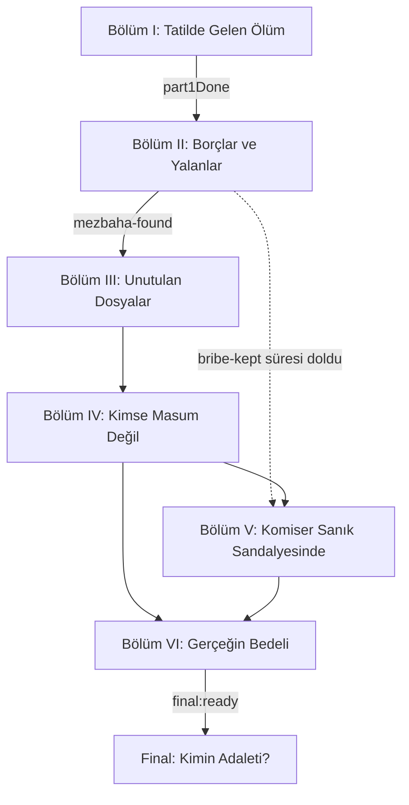

# 4. Ana hikâyenin bölüm iskeleti

Bölümler zorunlu görevler değil, **anlatı evreleridir**. Oyuncu birçok olayı
farklı sırayla keşfedebilir. Bir bölüm, onu açan bayraklarla başlar ve onu
kapatan bayraklarla biter; aradaki her şey sandbox.

Yollar birleşebilir, ama önceki seçimlerin sonuçlarını taşımalıdır
(bayraklar ve sayılar kalıcıdır).

## Şablon

```markdown
## Bölüm N — Ad
**Durum:** [KANON] / [ÖNERİ]
**Açılış:** hangi bayrak(lar)
**Kapanış:** hangi bayrak(lar)

- **Oyuncunun amacı:** ...
- **Öğrenilebilecek gerçekler:** (01'den hangileri, hangi düzeyde)
- **Açılan karakterler:** ...
- **Deliller ve uygulamalar:** ...
- **Büyük kararlar:** (05'teki ikilemler)
- **Değişen sayılar:** (trust, pressure, integrity, witnessDanger...)
- **Yan hikâyeler:** (bu evrede açılabilenler)
- **Alternatif yollar:** bir yol kapanırsa bilgiye nereden ulaşılır
```

## Bölüm I — Tatilde Gelen Ölüm
**Durum:** [KANON]
**Açılış:** oyunun başı
**Kapanış:** `part1Done`

- **Oyuncunun amacı:** Ne olduğunu anlamak, ekibi organize etmek.
- **Öğrenilebilecekler:** Berat'ın ölümü, ilk ifadeler, otopsinin intihar
  süsünü çürütmesi.
- **Uygulamalar:** MatesApp (Özge), Poltel (ifadeler, otopsi), News (ilk haber).
- **Kararlar:** Özge'ye sert mi meraklı mı yaklaşılacağı (`trust:Özge`).

## Bölüm II — Borçlar ve Yalanlar
**Durum:** [KANON] (kısmen)
**Açılış:** `part1Done`
**Kapanış:** `mezbaha-found`

- **Oyuncunun amacı:** Furkan'ı ve Adil'i bulmak.
- **Öğrenilebilecekler:** Paket, borç, parmak izi, kafe, defter, makam aracı,
  yanık harita, mezbaha.
- **Uygulamalar:** Harita (görevler), Pano ve Laboratuvar, Sinstagram (Furkan,
  Yusuf, Deniz, gizli Adil hesabı), Kayıtlar (tehdit), ZaferBank (rüşvet).
- **Kararlar:** Furkan sorgusunun tonu (`trust:Doğa`), Behram'la ilişki,
  rüşvetin iadesi (İkilem 1'in ilk adımı, `bribe-kept` süreli olayı).
- **Yan hikâyeler:** ilk bağımsız dosyalar (05).

## Bölüm III — Unutulan Dosyalar
**Durum:** [KANON, taslak] (28.10.2026)
**Açılış:** `mezbaha-found` (ya da daha önce: `heard:dead-line`, `news:old-case-found`)
**Kapanış:** `kerem:contact` (Kerem ilk kez yazar)

- **Oyuncunun amacı:** Berat'ın peşinden çıkan deri ceketli adamı bulmak.
- **Öğrenilebilecekler:** Ece Aydın'ın adı ve ölümü; Kerem'in adı, vakıfta
  gönüllü olduğu ve kameradaki adam olduğu; Berat'ı son iki ayda en çok Ece'nin
  hattından arandığı; narkotiğin cuma gecelerine göz yumduğu; kaymakamın
  Yılmaz'ın rakibi olduğu.
- **Kerem'e giden yollar** (birbirinden bağımsız):
  1. Yırtık fotoğraf + kamera karesi → Atakan'a sor (aynı adam mı?) → 8 dk
     sonra kart netleşir: vakıf gönüllü kartı → vakıf haritada → "Gönüllü
     kartının fotoğrafını göster" → Kerem'in adı.
  2. Sesli mesaj → Özge hattı sorgular (üç yıl önce ölmüş bir kadın) → "Hattın
     sahibi kim?" → Ece Aydın.
  3. News arşivinde takipsizlik haberi → Özge'ye kızın adını sor → Ece Aydın.
  4. Ece'nin adıyla → Sinstagram'da `ece.aydin` (Berat'ın "Aramıza hoş geldin"
     yorumu) → yorumlardaki `k.aydin` (bio: "Kardeşi.") → Kerem'in adı.
  5. Ece'nin adıyla → haritada Aydın ailesinin evi → komşular: "sakallı, deri
     ceketli" → Kerem'in adı.
- **Kimlik:** Kerem'in adı + kamera karesi + (aynı adam ya da gönüllü olduğu)
  → Atakan ehliyet fotoğrafını karşılaştırır → `kerem:identified`.
- **Kerem yazar:** Ece'nin hattından: "Kızlardan biri hâlâ hayatta. Cumaya
  kadar." Buluşma (`kerem:meeting`) Bölüm IV'te.
- **Kararlar:** Kerem'i sessizce mi aramalı, herkese mi duyurmalı
  (`kerem:wanted`); Ece'nin odasına izinsiz girmek (`player:dirty-hands`).
- **Gizli son ipuçları (`doubt`):** annenin sesli mesajı, Özge'nin sızıntı
  cevabı, İnanç'ın telefon kaydı, Erdi'nin "nerede olduğunu bilmiyoruz"u,
  Selin'in "gece üçte arayan".

## Bölüm IV — Kimse Masum Değil
**Durum:** [ÖNERİ]

- Hakan'ın hikâyesi, kayıp öğrenciler, ekibin kişisel ilişkileri ve politik
  baskı derinleşir. Oyuncu meslektaşlarının gerçeklerini öğrenmeye başlar.
- İkilemler: 2, 3, 4, 5, 9.

## Bölüm V — Komiser Sanık Sandalyesinde
**Durum:** [ÖNERİ]

- Oyuncunun seçimlerine göre idari inceleme (`case:internal-investigation`),
  görevden uzaklaştırma (`status:suspended`), meslekten çıkarılma
  (`status:dismissed`) ya da adli süreç (`legal:warrant-issued`).
- Poltel kilitlenir; Harita'da sadece komisere güvenen subaylar yardım eder;
  News, Sinstagram, gazeteciler ve eski meslektaşlar temel araç olur.
- Hiçbiri zorunlu değil. Yasal yoldan ilerleyen oyuncu bu bölümü görevde
  geçirir; o zaman baskı (`pressure`) ve Erdi üzerinden yaşanır.
- İkilemler: 6, 10.

## Bölüm VI — Gerçeğin Bedeli
**Durum:** [ÖNERİ]

- Cinayetin ve bağlantılı suçların önemli kısmı ortaya çıkar. Oyuncu artık
  kimin suçlu olduğuna değil, **hangi delili kime vereceğine ve kimi
  koruyacağına** karar verir.
- İkilemler: 7, 8.

## Final — Kimin Adaleti?
**Durum:** İskelet [KANON], metinler [ÖNERİ]
**Açılış:** `final:ready`

Bkz. 08-finaller.md.

## Bölüm geçiş haritası


