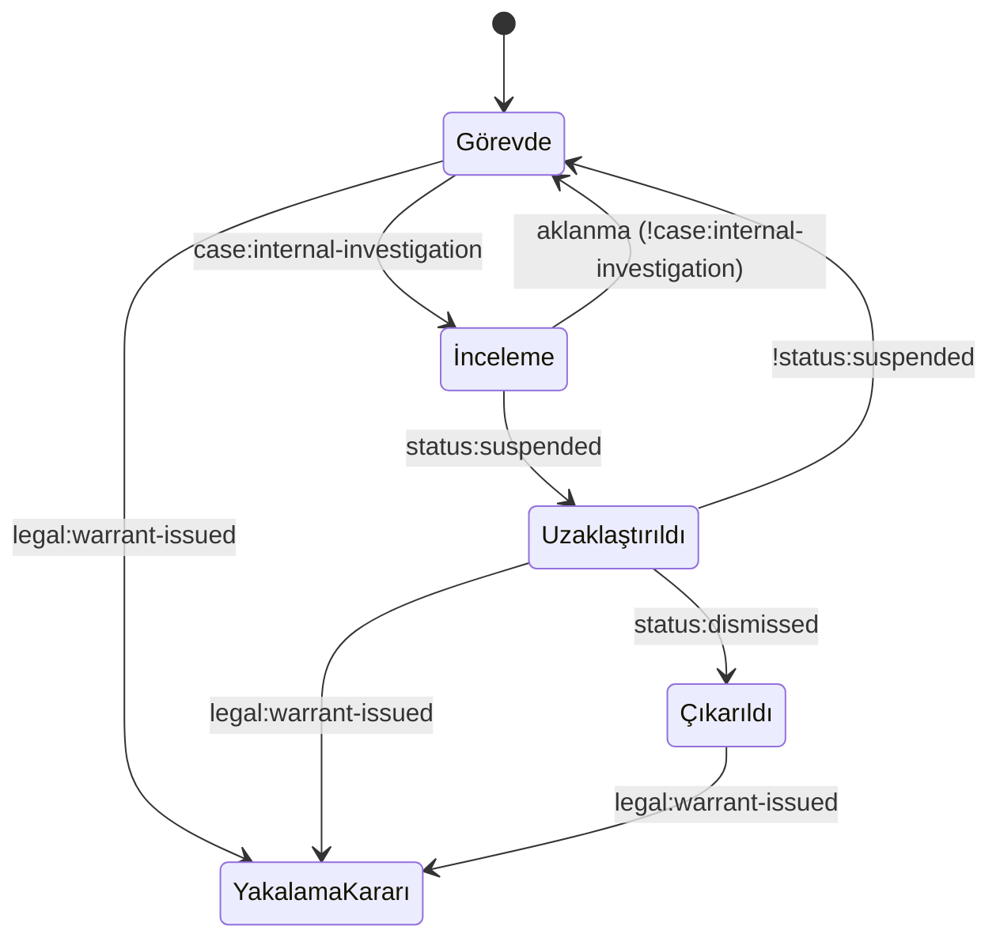

# 6. Durumlar ve seçim-sonuç matrisi

Oyunun hafızası iki şeyden oluşur: **bayraklar** (açık/kapalı) ve
**sayılar**. Her ikisi de kalıcıdır; bir seçim sadece bir sonraki mesajı
değiştirip unutulmaz. Yazım kuralları için `story/STORY_FORMAT.md`.

## Sayılar (state.json › stats)

| Sayı | Anlamı | Başlangıç | Artıran | Azaltan |
| --- | --- | --- | --- | --- |
| `trust:Özge` ... `trust:Behram` | O kişinin komisere güveni | 50 | Dürüstlük, onu korumak, sözünü tutmak | Kabalık, onu ifşa etmek, verilen sözü bozmak |
| `pressure` | Üstlerden gelen baskı | 20 | Erdi'yi dışarıda bırakmak, rüşveti iade etmek, milletvekilini kurcalamak | [?] |
| `integrity` | Mesleki dürüstlük | 70 | Usule uygun davranmak, rüşveti iade etmek | Delil saklamak, usulsüz erişim, para kabul etmek |
| `witnessDanger` | Tanıkların tehlike düzeyi | 10 | Aceleci baskınlar, sızıntılar, yayımlanan haberler | Tanık koruma |

Kendiliğinden olanlar: `trait:<özellik>` (kişilik puanı) ve `paid:<alıcı>`
(gönderilen para, lira).

[?] Eklenebilecekler: `publicOpinion` (kamuoyu), `trust:<gazeteci>`,
`evidence:admissible` gibi mahkeme sayıları.

## Bayrak adlandırma

| Önek | Anlamı | Örnek |
| --- | --- | --- |
| `partN`, ad | Bölüm ilerlemesi | `part1Done`, `furkanStatement` |
| `heard:` | Bir isim ya da bilgi duyuldu | `heard:adil` |
| `ev:` | Delil bulundu | `ev:torn-photo` |
| `seen:` | Bir profil/kayıt görüldü | `seen:adil` |
| `poltel:` | Kısıtlı kayda erişildi | `poltel:ozge-file-read` |
| `news:` | Haber okundu | `news:old-case-found` |
| `sent:` | Alıcıya para gönderildi (kendiliğinden) | `sent:bribe-return` |
| `bribe:` | Rüşvet hikâyesi | `bribe:returned` |
| `case:` | Soruşturmanın durumu | `case:internal-investigation`, `case:solved` |
| `status:` | Komiserin mesleki durumu | `status:suspended`, `status:dismissed` |
| `legal:` | Komiserin hukuki durumu | `legal:warrant-issued` |
| `witness:` | Tanıkların durumu | `witness:protected` |
| `press:` | Basın | `press:story-published` |
| `player:` | Komiserin kendi suçları | `player:dirty-hands` |
| `final:` | Oyunun sonu | `final:ready` |

Planlanan ama henüz hiçbir şeyin açmadığı bayraklar `state.json › flags`
sözlüğüne yazılır. Doğrulama aracı bunları hata değil NOT olarak listeler.

## Komiserin mesleki ve hukuki durumu

| Uygulama | Görevde | Uzaklaştırılınca (şu an çalışan) | [ÖNERİ] ek etkiler |
| --- | --- | --- | --- |
| Poltel | Tam erişim | Kilitli (`locks`) | |
| Harita | Bütün subaylar | Sadece güveni 60 ve üstü olanlar | |
| MatesApp | Resmî ekip | Aynı | Kişisel ilişkilerden bilgi |
| News | Kaynak | Aynı | Temel araç |
| ZaferBank | Normal | Aynı | Adli kısıtlama, hesap incelemesi |
| Phone | | | Avukat, gazeteci, eski meslektaş |

Yurt dışında olmak, yakalama kararının otomatik etkisiz olduğu anlamına
gelmez: uluslararası süreçler ve bulunulan ülkenin kararları önemlidir.

## Seçim-sonuç matrisi

Bir seçim birden fazla sonucu tetikleyebilir. Her büyük karar buraya yazılır.

| Karar | Seçenek | Bayraklar | Sayılar | Sonradan nerede karşısına çıkar |
| --- | --- | --- | --- | --- |
| Erdi'nin baskısı | Boyun eğ | `pressure:erdi` | integrity −5 | İnanç'tan kayıtlar Erdi'ye gider |
| Erdi'nin baskısı | Karşı çık | `pressure:erdi` | pressure +10 | |
| Kaymakam | Bilgi ver | `pressure:kaymakam`, `kaymakam:informed` | integrity −10 | [?] Bilgi sızar mı? |
| Kaymakam | Reddet / cevap verme | `pressure:refused` | pressure +10 / +5 | Erdi'nin uyarısı, gözdağı sesli mesajı |
| Furkan | Bırak / tut / tanık koruma | `furkan:released` / `furkan:held` / `furkan:protected` | witnessDanger +15 / −5 / −10 | [?] |
| İnanç'a Erdi'nin emri | Ver / bana gönder / ikimize | | trust:İnanç −5 / +10 / +5 | İkilem 6 |
| Plaka sorgusu (Orhun) | Tutanağa geçir / sakla / azarla | | integrity +5 / `player:dirty-hands` / trust:Orhun −10 | |
| Rüşvet (İkilem 1) | İade et | `bribe:returned` | integrity +10, pressure +15 | Gözdağı SMS'i, babanın son mesajı, Erdi'nin uyarısı |
| Rüşvet (İkilem 1) | Hiçbir şey yapma (45 dk) | `case:internal-investigation` | integrity −15, pressure +10 | İç Denetim maili, Bölüm V |
| Atakan (İkilem 3) | İhbar et | [?] | trust:İnanç +, trust:Özge −, trust:Atakan −− | |
| Atakan (İkilem 3) | Koru | `player:dirty-hands` | trust:Atakan ++, integrity − | |
| | | | | |

## Alternatif yol kuralı

Bir karakterle ilişki bozulduğunda ya da bir yol kapandığında ana hikâyenin
çözülebilmesi için her **zorunlu** bilgi en az iki yoldan ulaşılabilir olmalı.
Bunu 07-dagitim.md'deki tabloda işaretle ve koşulları `requiresAny` ile yaz.
