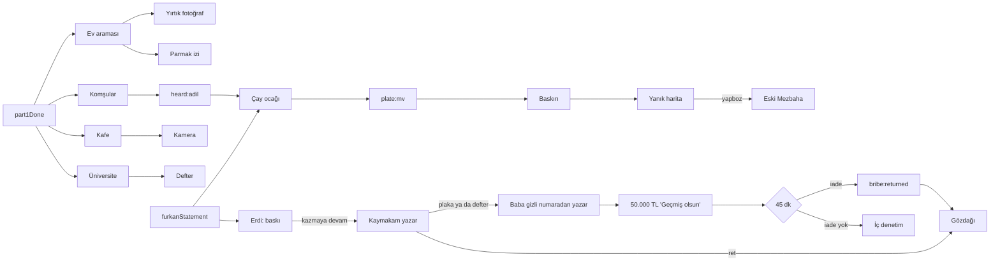

# 7. Telefon uygulamalarına dağıtım

Hangi bilgi hangi uygulamada bulunur ve ona kaç yoldan ulaşılır. Oyuncu
ipucunu nerede bulacağını önceden bilmemeli; raporlar ve mesajlar sadece
"orada bir şey var" demeli.

## Uygulamaların hikâyedeki rolü

| Uygulama | Ne taşır | Kullanılacak fikirler |
| --- | --- | --- |
| MatesApp | Ana hikâye, sorgular, ekibin sesi | Verilen bir söz başka bir sohbette karşısına çıkar; ekip üyeleri birbirleriyle konuşur, dedikodu yayılır |
| Poltel | İfadeler, raporlar, siciller, iç denetim, laboratuvar | Belgelerdeki çelişkiler; delilin gerçek olması hukuka uygun elde edildiği anlamına gelmez |
| Harita | Saha görevleri | Uzaklaştırılınca sadece güvenenler gider |
| Pano | Delillerin bağlantıları | Sonradan fark edilen ipuçları buraya kendiliğinden düşmez |
| News | Gündem ve arşiv | Yanlış ya da yönlendirilmiş haberler; sızan bilgi yeni manşet olur |
| Sinstagram | Şüpheli profilleri, eski gönderiler | Eski bir fotoğraf alibiyi çürütür ya da masum birini şüpheli yapar |
| ZaferBank | Para akışı, transferler | Rüşvet gibi görünen ödeme başka birini korumak için olabilir; banka bilgisi tek başına kanıt değildir |
| Kayıtlar | Tehditler, sesli mesajlar | |
| Mail | Resmî yazışmalar, iç denetim | |
| Messages | Anonim ihbarlar, sıradan hayat | Doğru ya da yanıltıcı ihbarlar |
| Calendar, Clock | Zaman | Süreli olaylar oyun süresiyle (`timers`) |

## Bilgi dağıtım tablosu

Her önemli bilgi bir satır. **Zorunlu** bilgiler en az iki yoldan
ulaşılabilir olmalı.

| Bilgi | Zorunlu | Birincil yol | Alternatif yol | Açan bayrak |
| --- | --- | --- | --- | --- |
| Adil'in adı | Evet | Furkan sorgusu (MatesApp) | Komşular (Harita) | `furkanStatement` / `heard:adil` |
| Adil'in yeri (çay ocağı) | Evet | Çay ocağı görünür | | `requiresAny: heard:adil, furkanStatement` |
| Makam aracı | Evet | Çay ocağı gözetleme | [?] | `plate:mv` |
| Mezbahanın yeri | Evet | Yanık harita yapbozu | [?] (News arşivi "eski mezbaha" haberi?) | `map-restored` |
| Borç ve "mezbaha" korkusu | Hayır | Defter (UV) | Deniz ifadesi (borç) | `notebook-read` |
| Bayıltıcı | Hayır | Toksikoloji (Adli Tıp görevi) | | `toxicology` |
| Eski örtbas edilmiş ölüm | [?] | News arşivi araması | [?] | `news:old-case-found` |
| Adil'in gizli hesabı | Hayır | Sinstagram araması | Yorumdaki kullanıcı adı | `seen:adil` |
| | | | | |

Mezbahaya şu an tek yoldan ulaşılıyor. Bölüm III'e geçiş zorunluysa bir
alternatif eklenmeli.

## Bağlantı haritası

Bayraklar tarafının tamamı için: `dart run tool/validate_story.dart --graph`.

## İpucu bildirimleri [KARAR: mekanizma · Taslak: metinler]

Sohbet dışında, oyuncunun kendisinin başlatması gereken seçenekler (şimdilik
ZaferBank'tan para göndermek) kolayca gözden kaçıyor. Bunlar için seçenek
açıldıktan bir süre sonra, oyuncu hâlâ bir şey yapmadıysa tek bir bildirim
gelir. Bildirim seçeneği gösterir ama ne yapılması gerektiğini söylemez:
"iade edebilirsiniz", "iade etmelisiniz" değil.

- Ses, uygulamanın kendi sesi: gerçek bir bankanın "hatalı gelen ödemeyi
  iade edebilirsiniz" bildirimi gibi. Hikâyedeki birinin ağzından değil.
- Her seçenek için en fazla bir ipucu; asıl süreli olaydan (ör. `bribe-kept`,
  45 dk) epey önce gelir ki oyuncunun karar vermeye vakti olsun.
- Oyuncu Settings › İpucu bildirimleri'nden kapatabilir. İpuçları hiçbir
  bayrak açmaz; kapalıyken oyun aynı akar.
- Teknik karşılığı: state.json › `hints`.

| İpucu | Ne zaman | Gelmez | Bildirim |
| --- | --- | --- | --- |
| Rüşvetin iadesi | `mp:wrote` + 10 dk | İade edildiyse | ZaferBank: gelen EFT'yi Para Gönder › Gönderene iade ile geri gönderebilirsiniz |
| Orhun'un borcu | `heard:orhun-debt` + 6 dk | Para gönderildiyse | ZaferBank: Orhun K. kayıtlı alıcılarınızda |
| Avukat ücreti | `lawyer:offer` + 3 dk | Ödendiyse ya da oyuncu reddettiyse | ZaferBank: Av. Nesrin Kaya kayıtlı alıcılarınızda |

[?] Sohbet dışındaki başka seçenekler (laboratuvar, Poltel sorguları, harita
görevleri) de ipucu istiyor mu? Oyun testinde gözden kaçan çıkarsa eklenir.
